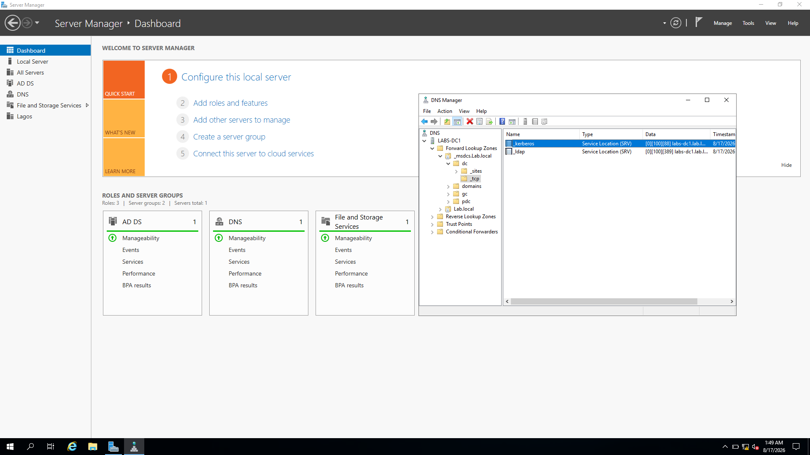
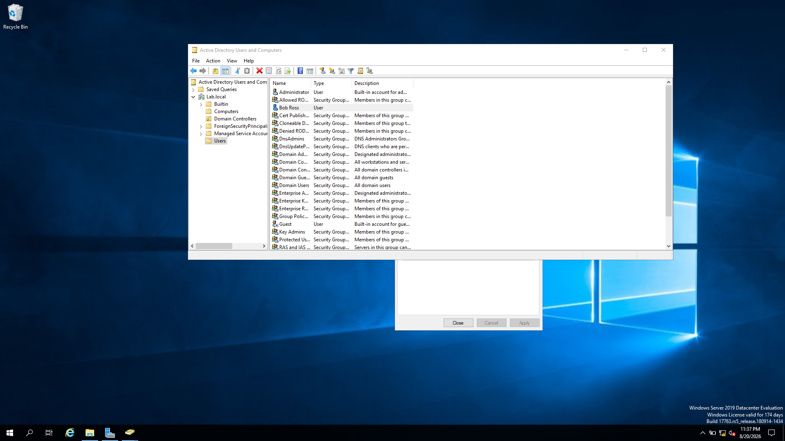
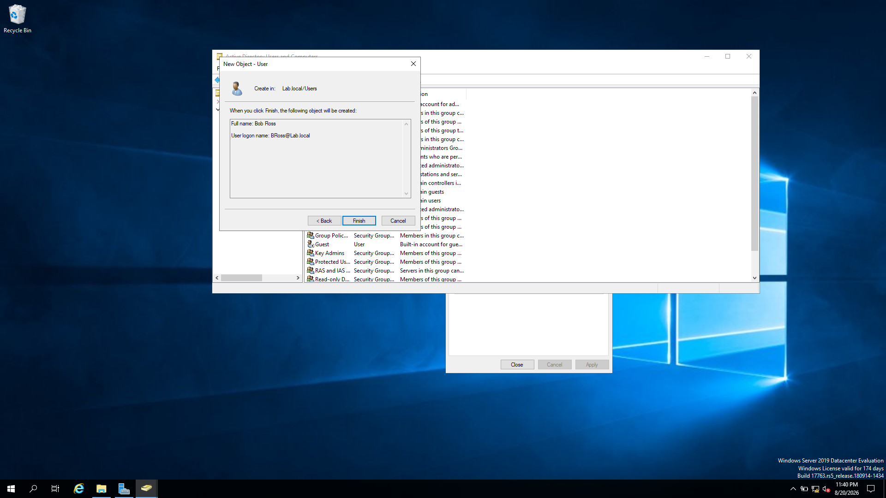
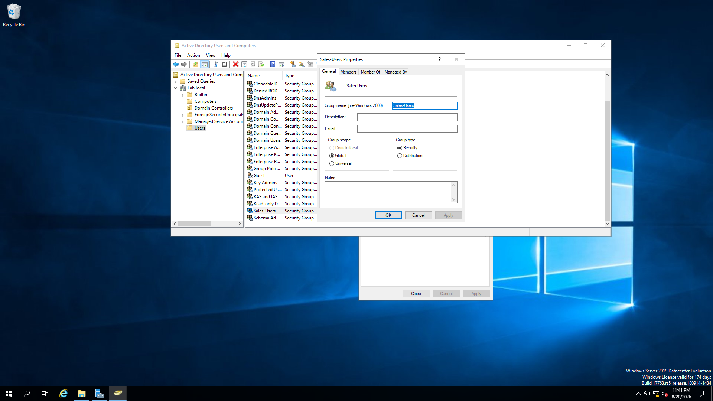
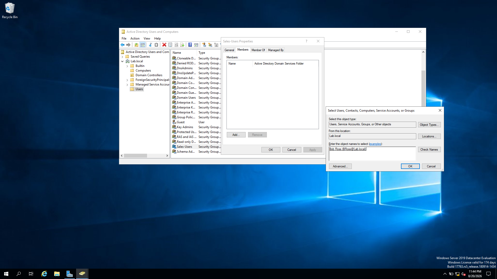
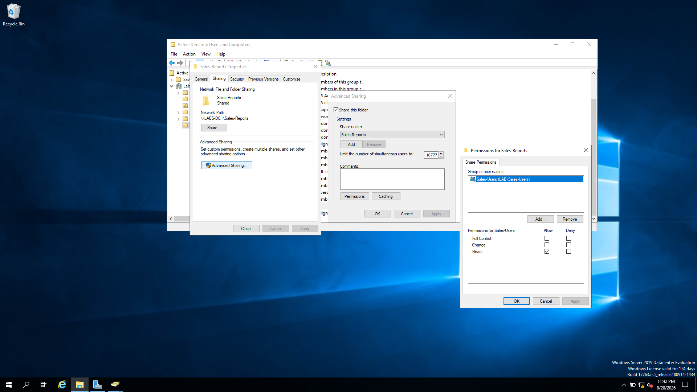
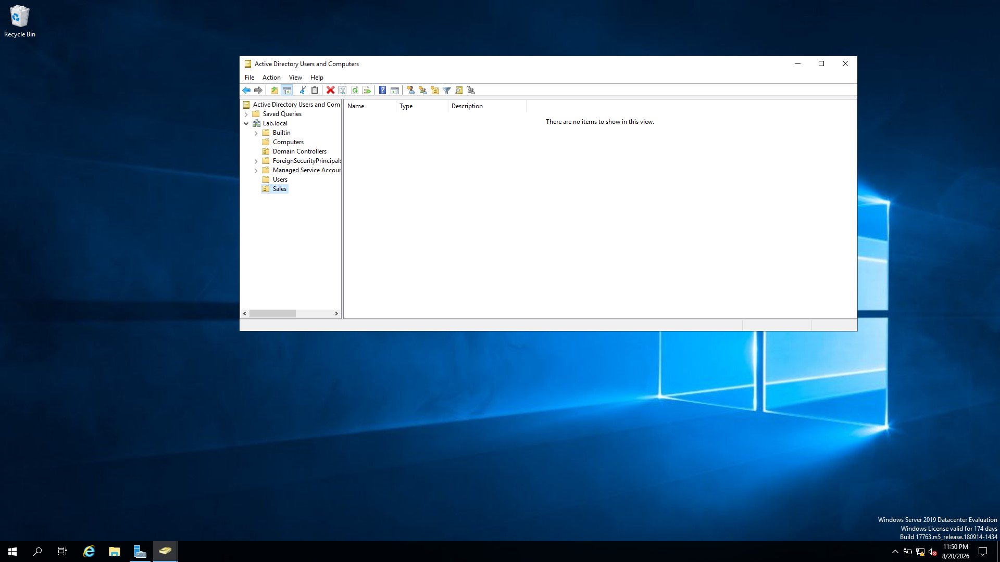
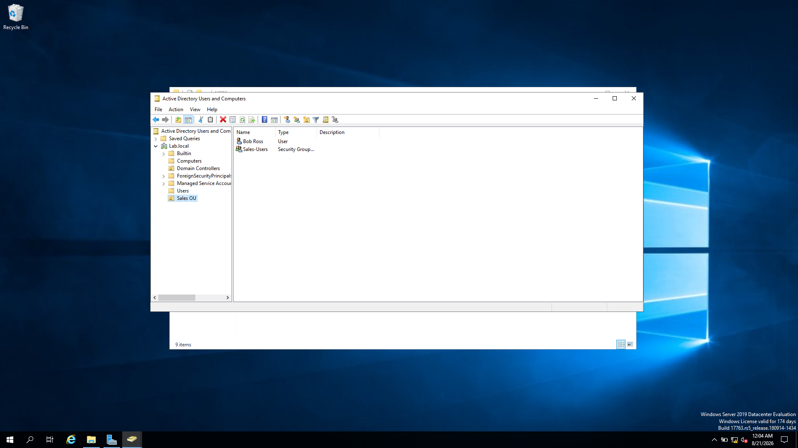
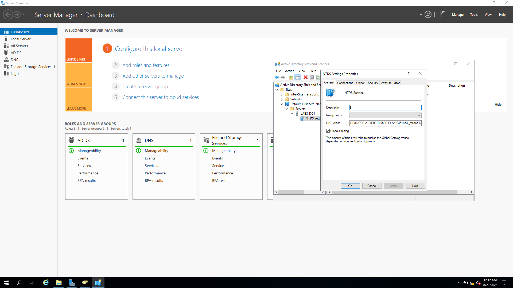

# Windows Server Administration Lab Portfolio

A visual, documentation only portfolio of Windows Server administration tasks completed in a learning lab. The screenshots below show the work, with notes on the purpose and real world relevance of each task.


## Skills demonstrated

- Installing the Active Directory Domain Services (AD DS) and DNS roles
- Creating and managing Active Directory user accounts
- Creating security groups and managing group membership
- Configuring read only access for a group to a folder
- Creating Organisational Units (OUs) and organising directory objects
- Enabling or checking the Active Directory Global Catalog
- Recording configuration evidence and documenting administrative tasks

## Lab environment

Complete these details if you know them:

- **Windows Server version:** 2019 
- **Domain name:** LAB.LOCAL
- **Server hostname:** DC01 
- **Virtualisation platform:** Virtual Box 


---

## 1. Install AD DS and DNS roles

**Objective:** Prepare Windows Server for directory services and name resolution.

**Why it matters:** Active Directory provides centralised identity and access management. DNS is essential for clients and domain controllers to locate directory services.

**Evidence**



*Figure 1: Server Manager showing the AD DS and DNS role installation stage.*


---

## 2. Create a user account

**Objective:** Create an Active Directory user account.

**Why it matters:** User accounts represent identities that can be authenticated and managed centrally.

**Evidence**





*Figures 2–3: Screenshots documenting user-account creation.*


---

## 3. Create a Sales security group and add a member

**Objective:** Create a `Sales` security group and add the intended user to it.

**Why it matters:** Group-based access control makes permissions easier to manage when people join, leave, or change teams.

**Evidence**






*Figures 4–6: Sales group creation and group-membership evidence.*


---

## 4. Configure read-only access to the Sales Reports folder

**Objective:** Configure read-only access for the Sales group on the Sales Reports folder.

**Why it matters:** Least privilege means giving users only the access they need. Read-only access helps prevent accidental or unauthorised changes to shared reports.

**Evidence**



*Figure 7: Permissions configured for the Sales group on the Sales Reports folder.*


---

## 5. Create a Sales Organisational Unit and organise directory objects

**Objective:** Create a Sales OU and move the relevant user and group objects into it.

**Why it matters:** OUs help administrators organise directory objects, delegate administration, and target Group Policy. An OU is not the same thing as a security group and does not itself grant folder permissions.

**Evidence**







*Figures 8–12: OU creation, object movement, and the resulting directory structure.*


---

## 6. Enable or verify the Global Catalog setting

**Objective:** Enable or check the Global Catalog setting on the intended domain controller.

**Why it matters:** Global Catalog servers support forest-wide searches and contribute to logon-related directory operations.

**Evidence**



*Figure 13: Screenshot of the Global Catalog configuration stage.*


---

## Repository structure

```text
.
├── README.md
├── evidence/                  # Original lab screenshots
├── labs/                      # Written guides for each lab
├── architecture/              # Space for a network or directory diagram
└── troubleshooting/            # Space for notes on issues and resolutions
```


